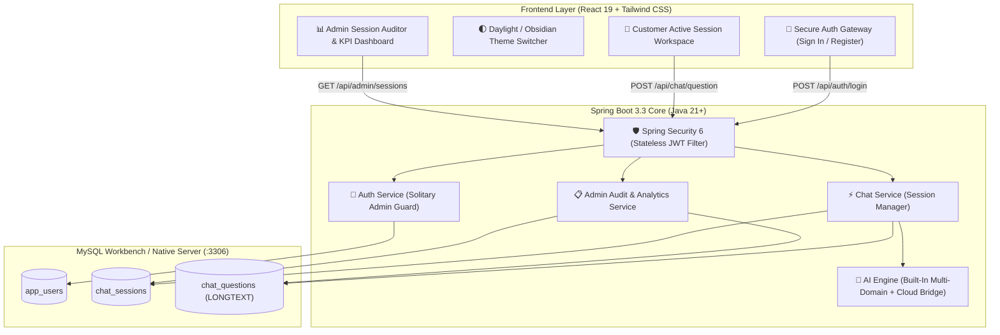
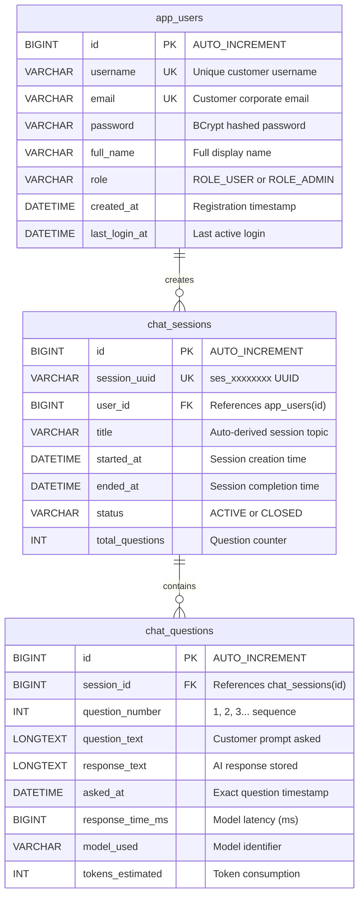

<div align="center">

# 🦄 NovaChat AI
### **Enterprise Conversational Intelligence & Audit Platform**

*Full-Stack Architecture with Java Spring Boot 3.3, Native MySQL Workbench 8.0, React 19, Tailwind CSS & Dynamic Multi-Domain AI*

<br/>

[](https://spring.io/)
[](https://openjdk.org/)
[](https://www.mysql.com/)
[](https://react.dev/)
[](https://tailwindcss.com/)
[](https://spring.io/)
[](https://gradle.org/)

<br/>

**[⚡ Quick Launch](#-quick-launch-guide) • [✨ Key Capabilities](#-unicorn-saas-capabilities) • [🏗️ Architecture](#️-system-architecture) • [💾 MySQL Workbench](#-mysql-workbench-integration) • [🔐 Security & Roles](#-enterprise-security--personas)**

</div>

---

## 🎨 Visual Interface Preview

```
┌────────────────────────────────────────────────────────────────────────────────────────┐
│  🦄 NovaChat AI   [Unicorn SaaS]        [ ☀️ / 🌙 Theme ]  [ 👑 Sole Admin / 👤 Customer ] │
├────────────────────────────────────────────────────────────────────────────────────────┤
│                                                                                        │
│   ┌────────────────────────────────────────┐   ┌───────────────────────────────────┐   │
│   │  👤 CUSTOMER WORKSPACE                 │   │  👑 SOLE ADMIN CONTROL CENTER     │   │
│   │                                        │   │                                   │   │
│   │  • Activated strictly post-login       │   │  • Real-Time SaaS KPI Dashboard   │   │
│   │  • Distraction-free ephemeral sessions │   │  • Complete User Session Auditor  │   │
│   │  • Zero past chat leakage to users     │   │  • Chronological Question Logs    │   │
│   │  • Instant multi-domain AI answers     │   │  • Latency & Token Analytics      │   │
│   │  • Zero customer API keys required     │   │  • Live MySQL Relational Records  │   │
│   │  • Markdown syntax code copy           │   │  • Strictly 1 Super Admin allowed │   │
│   └────────────────────────────────────────┘   └───────────────────────────────────┘   │
│                                                                                        │
└────────────────────────────────────────────────────────────────────────────────────────┘
```

---

## ✨ Unicorn SaaS Capabilities

* ☀️ **Instant Light / Dark Mode Toggle:** Seamless one-click daylight & obsidian dark modes with smooth micro-transitions and synchronized local persistence.
* 🧠 **Zero API Key Requirement:** Works **100% out of the box with zero external API keys**. The built-in multi-domain engine answers questions across physics, thermodynamics, algorithms, database optimization, backend architecture, and general queries.
* 🌐 **Optional Server-Side Cloud AI:** If live Google Gemini cloud connectivity is desired for arbitrary web knowledge, simply set `gemini.api-key` in `application.yml` on the backend. **Customers never see, enter, or manage API keys**.
* 🔒 **Zero Customer Chat Leakage:** Standard users chat exclusively within their active session. Prior chat histories are kept ephemeral from users for confidentiality and a clean interface.
* 👑 **Solitary Super Admin Governance:** The application strictly enforces only **one** Super Admin (`ROLE_ADMIN`). Standard user registrations are sandboxed exclusively to `ROLE_USER` with strict privilege escalation safeguards.
* 🕵️ **Full Administrative Question Audit:** The sole Super Admin has access to the **Admin Control Center**, allowing complete inspection of every customer session and every single question and answer asked.
* 💾 **Direct MySQL Workbench Persistence:** All registered users, active sessions, and conversational dialogue are persisted directly into your native MySQL Server (`novachat_db`) with `LONGTEXT` storage.

---

## 🏗️ System Architecture



---

## 📊 Database Entity Relationship Model

The database schema is organized into normalized relational tables inside `novachat_db`:



---

## 🔐 Enterprise Security & Personas

| Feature | 👤 Customer Account (`ROLE_USER`) | 👑 Super Admin (`ROLE_ADMIN`) |
| :--- | :---: | :---: |
| **Authentication Requirement** | Required (JWT Bearer Token) | Required (Encrypted Credentials) |
| **Number of Allowed Accounts** | Unlimited (via Registration) | **Strictly Solitary (Only One Account)** |
| **Interactive Chat Workspace** | ✅ Active Session Access | ✅ Full Access |
| **Chat History Retention in UI** | ❌ Ephemeral (Not Maintained) | ✅ Complete Relational History |
| **Inspect Other Users' Sessions** | ❌ Strictly Prohibited (403) | ✅ Complete Audit Access |
| **Inspect All Question Logs** | ❌ Blocked | ✅ Chronological Logs & Tokens |
| **SaaS Metrics & Analytics** | ❌ Blocked | ✅ Real-Time KPI Cards |

### Credentials:

* **👑 Sole Super Admin:**
  * **Username:** `admin`
  * **Password:** `Admin@NovaChat2026!`
  * **Role:** `ROLE_ADMIN` *(Only 1 exists; hidden from normal customers)*
* **👤 Standard Customer Account:**
  * **Username:** `sarah`
  * **Password:** `User@NovaChat2026!`
  * **Role:** `ROLE_USER`

*(New accounts created via "Sign Up" are automatically assigned standard `ROLE_USER` status and have zero admin privileges).*

---

## 💾 MySQL Workbench Integration

The backend connects directly to your native local MySQL installation without Docker or containers:

* **Host / Port:** `localhost:3306`
* **Database:** `novachat_db`
* **Username:** `root`
* **Password:** `@246810Alpha`

### Live Inspection Queries:

Open **MySQL Workbench**, connect to your local server, and run:

```sql
USE novachat_db;

-- 1. View all recorded chat sessions by user:
SELECT s.session_uuid, u.username, u.email, s.title, s.total_questions, s.status, s.started_at
FROM chat_sessions s
JOIN app_users u ON s.user_id = u.id
ORDER BY s.started_at DESC;

-- 2. View all customer questions and AI answers:
SELECT q.question_number, q.question_text, q.response_time_ms, q.tokens_estimated, q.asked_at
FROM chat_questions q
ORDER BY q.asked_at DESC;
```

---

## 🧠 AI Engine Modes: Offline vs Live Cloud

### 1. Offline Mode (Default - Zero API Keys Required)
The application works immediately out-of-the-box without configuring any keys. The engine dynamically answers queries across:
- **Science & Physics:** Thermodynamics (all 4 laws, heat transfer, entropy, cycles), mechanics, quantum physics, relativity.
- **Computer Science & Algorithms:** QuickSort, MergeSort, Binary Search, Big-O complexity, data structures.
- **Full-Stack & Databases:** MySQL Workbench optimization, indexing, ACID transactions, Spring Boot, React 19.
- **Identity & General:** "What is your name", greetings, math, and dynamic analytical synthesis.

### 2. Live Cloud Mode (Optional)
If you wish to enable Google Gemini cloud generation for any arbitrary question in the world, simply add your key on the server in [`backend/src/main/resources/application.yml`](file:///C:/Users/ankit/.gemini/antigravity/scratch/novachat-ai/backend/src/main/resources/application.yml):
```yaml
gemini:
  api-key: "YOUR_GEMINI_API_KEY_HERE"
```
Or export it via environment variable:
```powershell
$env:GEMINI_API_KEY="YOUR_GEMINI_API_KEY_HERE"
```
*Note: The customer UI will NEVER ask the customer for keys—all AI routing is strictly handled server-side.*

---

## 🚀 Quick Launch Guide

### 1-Click Launch (Windows):
Double-click:
```cmd
start.bat
```

### Manual Launch:

#### Step 1: Start the Spring Boot Backend
```powershell
cd backend
.\gradlew.bat bootRun
```
*Backend runs on `http://localhost:8080` and connects directly to MySQL Workbench.*

#### Step 2: Start the React Frontend
```powershell
cd frontend
npm run dev
```
*Frontend runs on `http://localhost:5173`.*

#### Step 3: Open in Browser
Visit **`http://localhost:5173`**
1. Switch between ☀️ **Light Mode** and 🌙 **Dark Mode** via the top toggle.
2. Sign in as a Customer to chat in a clean, private session.
3. Sign in as Super Admin (`admin` / `Admin@NovaChat2026!`) to audit customer questions and sessions!

---

<div align="center">
  <sub>Built for Unicorn SaaS Architecture • Spring Boot 3.3 • MySQL Workbench • React 19</sub>
</div>
